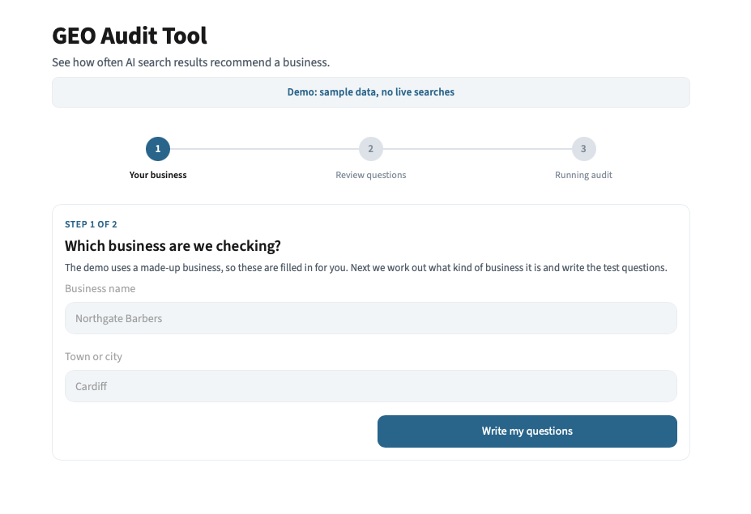
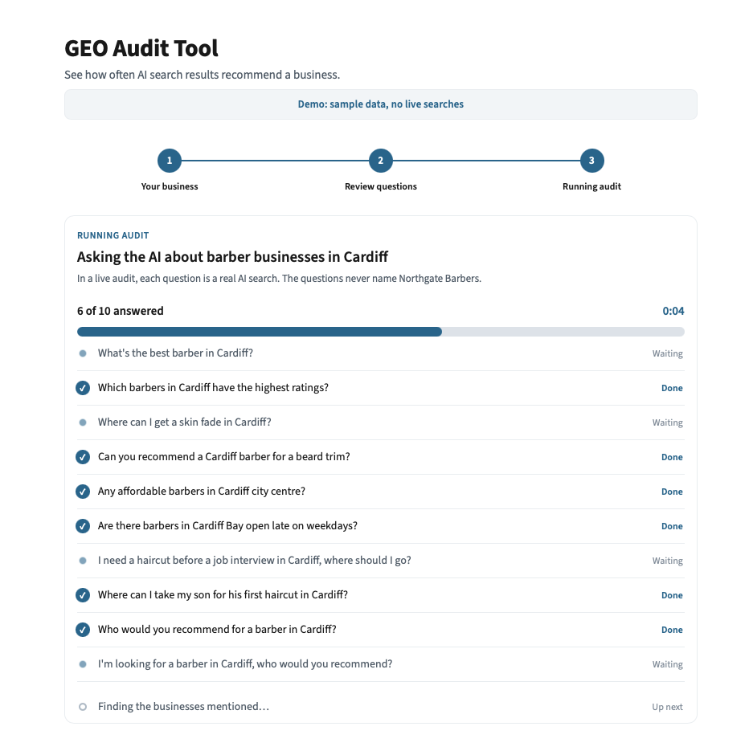
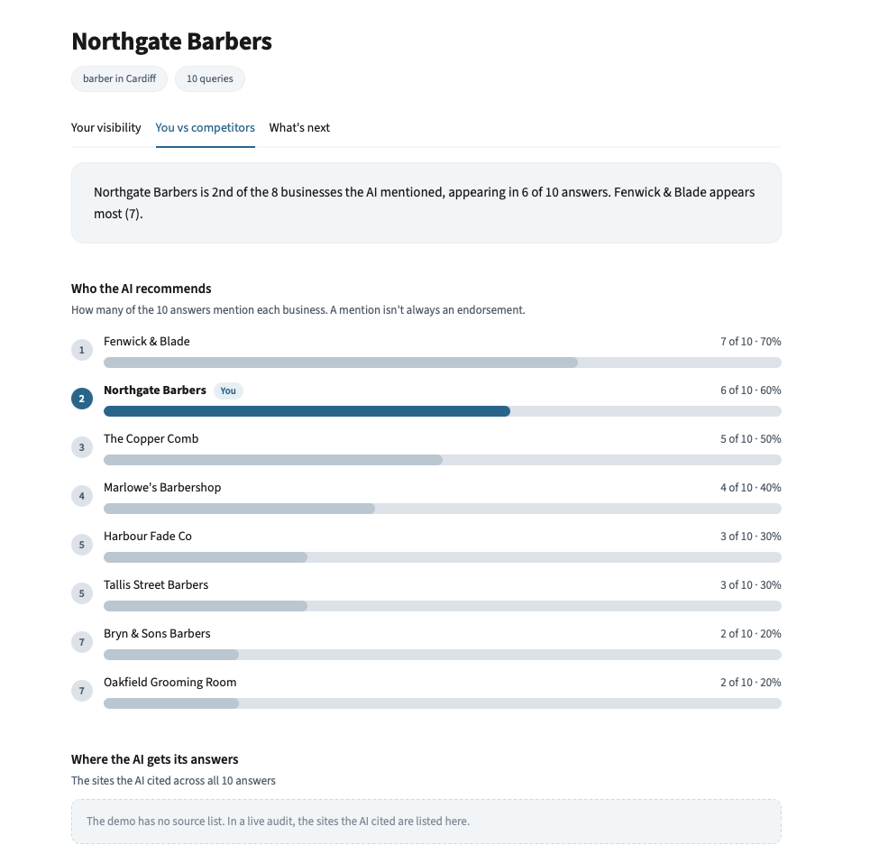

# GEO Audit Tool

This tool measures how often an AI search assistant recommends a business.

More people now ask an AI assistant "who's the best barber in Cardiff?" instead
of scrolling through search results. If the answer doesn't mention your
business, you're invisible to them. The tool asks an AI a set of realistic
customer questions, then counts how many of the answers mention the business.
That count is its **share of voice**.

The screenshots below come from the built-in demo, which uses a made-up
business called **Northgate Barbers**. The detection examples use **Lazarou
Barbers**, a real barber in Cardiff.

---

## What it does

1. **Two inputs** ([app.py](app.py)). You give the business name and its town.

   

   *The first screen in demo mode. The two fields are filled in and locked.*

2. **Query generation** ([querygen.py](querygen.py)). One cheap model call, with
   no web search, works out what kind of business it is. It then writes 10
   questions a customer might ask, two for each of five fixed types:

   | Type | What the customer wants |
   |---|---|
   | best | the best business of this kind in town |
   | service | one specific service |
   | constraint | to fit a price, opening hours or location |
   | situation | help with a particular occasion or need |
   | recommendation | a straight "who would you recommend?" |

   The questions never include the business's name, because the test is whether
   the AI recommends it without being asked. The code checks this, so it doesn't
   depend on the model following the prompt.
3. **Review screen.** You see the niche and the 10 questions before anything is
   spent. An "Edit questions" switch lets you change them. If the model wasn't
   sure what kind of business it is, the screen opens in edit mode with the
   niche flagged.
4. **Saved query sets.** The approved questions are stored against the business
   and town in SQLite. Running the same business again reuses the same
   questions, so two runs can be compared.
5. **Audit** (`run_audit`). The 10 questions go to the model with the
   `web_search` tool, all at the same time. A separate loading page lists the
   questions and ticks each one off as its answer arrives, with a clock that
   counts the seconds. Each question, its answer and the sources it cited are
   saved to [latest_run.json](latest_run.json). If the page reloads part-way
   through, the audit is not started a second time.

   

   *The loading page part-way through: 6 of 10 answered, with finding the
   businesses still to come.*

6. **Competitors from the answers** ([extraction.py](extraction.py)). One more
   cheap call lists every business the answers mention. The model only lists
   the names. The code counts how many answers each name appears in, so a
   business the model makes up can't reach the screen.
7. **Results** ([pages/results.py](pages/results.py)) has three tabs:
   - **Your visibility**: your share of voice, and which questions you appear in.

     

     *Northgate Barbers appears in 6 of the 10 answers. The questions it
     appears in and the 4 it misses are listed side by side.*

   - **You vs competitors**: every business the AI mentioned, ranked, with yours
     marked. It also lists the sources the AI cited.

     

     *Every business the answers mention, ranked by how many answers name it.
     The demo has no source list, so that section is empty here.*

   - **What's next**: a recap, a form to leave your details, and a "Start
     again" button that takes you back to the first screen.

## Demo mode and live audits

The app opens in **demo mode**. It walks a made-up business ("Northgate
Barbers" in Cardiff) through the same screens using saved sample data from
[demo_run.json](demo_run.json). It makes no API calls. Every screen is labelled
"Demo: sample data, no live searches". Every business in the demo is invented,
and the demo cites no sources. The questions can't be edited and the details
form is a locked example, so nothing can be sent.

**Live audits** cost real money, so they need a password. The password is read
from the `AUDIT_PASSWORD` environment variable. If the variable isn't set, only
the demo works and there is no way to start a live audit. With it set, the
first screen has a "Run a live audit" panel that asks for the password. A saved
live run is only shown to someone who has entered it.

---

## Detection

The hard part is deciding whether a specific business appears in an answer.
Simple text matching goes wrong in three ways. Names get shortened. Different
businesses share common words ("City Barbers" and the word "barber"). And an
answer can mention a business only to dismiss it.

The detection code ([detection.py](detection.py)) picks one of two methods for
each business name. The rule is that the choice may change the cost but never
the accuracy.

1. `distinctive_tokens()` lower-cases the name and removes the category, the
   location and legal suffixes such as Ltd. It keeps only rare words, using
   [`wordfreq`](https://pypi.org/project/wordfreq/) with a zipf frequency below
   `2.5`. For "Lazarou Barbers" that leaves `lazarou`.
2. `has_anchor()` asks whether the name has a rare word like that.
   - **If it does**, `cheap_match()` runs a free word-boundary regex check. This
     is safe because a rare, coined word won't collide with everyday words.
   - **If it doesn't** (a generic name like "City Barbers"), an LLM judge
     (`judge()`) decides whether the business is really present. It accepts
     shortened names and rejects businesses that only share a word.

Generic names always get the accurate, paid check. Only clearly distinctive
names take the free one. Judge verdicts are cached on the results page
(`@st.cache_data`), so viewing it again doesn't cost anything.

---

## Tech stack

- **Python** and **[Streamlit](https://streamlit.io/)** (two pages: the wizard
  and the results)
- **OpenAI Responses API**: `gpt-5.5` with the `web_search` tool for audits and
  plain calls for the judge, and `gpt-6-luna` for query generation and
  business extraction
- **`wordfreq`** to tell rare words from common ones
- **SQLite** ([init_db.py](init_db.py)) for form submissions and saved query sets

---

## Setup

```bash
# 1. create and activate a virtual environment
python -m venv venv
source venv/bin/activate        # Windows: venv\Scripts\activate

# 2. install dependencies
pip install -r requirements.txt

# 3. add your OpenAI key, and a password for live audits
#    (without AUDIT_PASSWORD the app runs in demo mode only)
echo "OPENAI_API_KEY=sk-..." > .env
echo "AUDIT_PASSWORD=choose-a-password" >> .env

# 4. create the SQLite database
python init_db.py

# 5. run the app
streamlit run app.py

# run the tests (every API call is faked, so they cost nothing)
python -m unittest discover -s tests
```

---

## Repository layout

| File | Purpose |
|------|---------|
| [app.py](app.py) | The wizard, review screen, loading page and the paid `run_audit` |
| [querygen.py](querygen.py) | Query-generation prompt, checks on the reply, saved query sets |
| [extraction.py](extraction.py) | Business-extraction prompt, counting and ranking |
| [pages/results.py](pages/results.py) | The three-tab results page |
| [detection.py](detection.py) | Decides whether a business appears in an answer |
| [theme.py](theme.py) | Shared styling for both pages |
| [modes.py](modes.py) | Demo data and the live-audit password check |
| [demo_run.json](demo_run.json) | The sample data used by demo mode |
| [init_db.py](init_db.py) | Creates the SQLite tables (`leads`, `query_sets`) |
| [tests/](tests/) | Unit and page tests against a fake API |
| [docs/](docs/) | Screenshots used in this README |
| [latest_run.json](latest_run.json) | The most recent saved live audit |
| [evaluate.py](evaluate.py) | A diagnostic script over a saved run |

---

## Limitations

- **A mention is not a recommendation.** `cheap_match` confirms a business is
  named, not that it's recommended. An answer that dismisses a business still
  counts. The same is true of the competitor ranking.
- **Audit speed.** A live audit waits on 10 real web searches. They run at the
  same time, so it takes about as long as the slowest one.
- **One saved run.** The results page shows one audit. A new audit replaces the
  previous one, and there is no tracking over time.
- **The niche is worked out from the name.** An unclear name can be guessed
  wrong. The review screen flags this and lets the owner correct it.
- **Questions differ between businesses.** The five types are fixed but the
  wording is written by a model. Compare two businesses by question type, not
  question by question.
- **The password check is basic.** There is no limit on wrong guesses, so use a
  long password if the app is public.
- **The competitor list may miss a business.** If the model fails to list a
  business, it won't be in the ranking. A made-up one can't appear, because it
  matches no answer.
