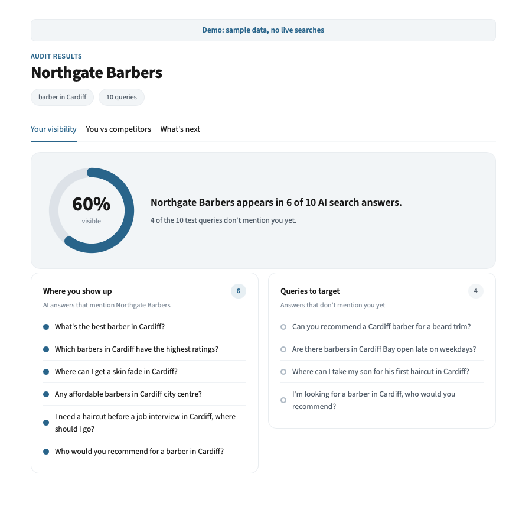

# GEO Audit Tool

Measure how often an AI search assistant recommends a given business, its
**share of voice** in generative search results.

As people increasingly ask LLM-backed assistants questions like *"best barber in
Cardiff"* instead of scrolling a results page, **being mentioned in the answer**
becomes the new ranking. This tool quantifies that: it puts a set of realistic
customer questions to a web-search-enabled model, then measures how often the
target business shows up across the answers.

The running example throughout is **Lazarou Barbers** — a barber in Cardiff.

---

## What it does

1. **Two inputs** ([app.py](app.py)): the business name and its town. Nothing else.
2. **Query generation** ([querygen.py](querygen.py)): one cheap model call (no web
   search) works out the niche from the name and town, then writes **10
   customer-sounding questions**: two for each of five fixed intent types.

   | Intent type | What the customer wants |
   |---|---|
   | best | the best or top-rated business of this kind in town |
   | service | one specific service |
   | constraint | to fit a price, opening hours or location |
   | situation | help with a particular occasion or need |
   | recommendation | a straight "who would you recommend?" |

   The questions **never include the business's name**: the test is whether the
   AI recommends it unprompted. That rule is enforced in code, not just in the
   prompt.
3. **Review screen**: the niche and the 10 questions are shown before anything is
   spent. They can be edited, and if the model wasn't sure of the niche the screen
   opens in edit mode with the niche flagged.
4. **Saved query sets**: the approved set is stored against the business + town
   (SQLite). Running the same business again reuses exactly the same questions,
   so two runs are comparable.
5. **Audit pipeline** (`run_audit`): the 10 questions go to the model with the
   `web_search` tool, concurrently, with a live "X of 10 answered" progress bar.
   Every query → answer (plus cited sources) is saved to
   [latest_run.json](latest_run.json).
6. **Competitors from the answers** ([extraction.py](extraction.py)): one more cheap
   call lists every business the 10 answers mention. The model only *lists* them;
   the counts are computed in code from what literally appears in each answer, so
   a business the model invents can't reach the screen.
7. **Dashboard** ([pages/results.py](pages/results.py)) reads the saved run and
   shows three tabs:
   - **Your visibility** — share-of-voice gauge + which queries you appear in vs. miss.
   - **You vs competitors** — a ranking of every business the AI mentioned, where
     yours sits in it, and which sources the AI cited.
   - **What's next** — a recap and a lead-capture form (stored in SQLite).

---

## Detection 

The core problem is deceptively hard: *did this specific business appear in this
answer?* Naive substring matching breaks on abbreviations, shared common words
(a rival "City Barbers" vs. the category "barber"), and dismissive mentions.

The solution ([detection.py](detection.py)) is a **hybrid router** whose guiding
principle is **"change the cost, not the accuracy"**:

1. `distinctive_tokens()` — lower-cases the name, strips the category, location,
   and legal suffixes (Ltd, LLC, …), then keeps only **rare tokens** using
   [`wordfreq`](https://pypi.org/project/wordfreq/) zipf frequency below `2.5`.
   For *"Lazarou Barbers"* this isolates `lazarou` — a distinctive anchor.
2. `has_anchor()` — does the name contain such a distinctive token?
   - **Yes** → `cheap_match()`: a free word-boundary regex check. Safe, because a
     rare, coined token can't collide with everyday words.
   - **No** (generic/ambiguous names like *"City Barbers"*) → fall back to an
     **LLM judge** (`judge()`) that reasons about whether the business is really
     present, tolerating abbreviations and rejecting shared-word false positives.

So ambiguous names always get the accurate (paid) path; only clearly-distinctive
names take the free shortcut. Judge verdicts are cached on the dashboard
(`@st.cache_data`) so repeated views don't re-pay.



*The router's verdicts rendered: 8 of 10 answers counted as a mention, with the
matched queries and the two misses listed side by side.*

---

## Tech stack

- **Python** + **[Streamlit](https://streamlit.io/)** (multipage: wizard + dashboard)
- **OpenAI Responses API** — model `gpt-5.5`, `web_search` tool for audits; plain
  calls for the judge; `gpt-6-luna` for query generation and business extraction
- **`wordfreq`** for the distinctiveness heuristic
- **SQLite** ([init_db.py](init_db.py)) for captured leads and saved query sets

---

## Setup

```bash
# 1. create + activate a virtual environment
python -m venv venv
source venv/bin/activate        # Windows: venv\Scripts\activate

# 2. install dependencies
pip install -r requirements.txt

# 3. add your OpenAI key
echo "OPENAI_API_KEY=sk-..." > .env

# 4. create the SQLite database
python init_db.py

# 5. run the app
streamlit run app.py

# run the tests (every API call is faked — free)
python -m unittest discover -s tests
```

---

## Repository layout

| File | Purpose |
|------|---------|
| [app.py](app.py) | Input wizard, review screen + the paid `run_audit` pipeline |
| [querygen.py](querygen.py) | Query-generation prompt, validation, name guard, saved query sets |
| [extraction.py](extraction.py) | Business-extraction prompt, code-side counting, ranking |
| [pages/results.py](pages/results.py) | Three-tab results dashboard |
| [detection.py](detection.py) | Hybrid detection router (tokens → cheap match / LLM judge) |
| [theme.py](theme.py) | Shared `geo-` visual design system for both pages |
| [init_db.py](init_db.py) | Creates the SQLite schema (`leads`, `query_sets`) |
| [tests/](tests/) | Unit and page tests against a fake API |
| [latest_run.json](latest_run.json) | One saved audit — the dashboard's data source |
| [evaluate.py](evaluate.py) | Diagnostic harness over a saved run |

---

## Limitations & future work

- **Presence, not endorsement.** `cheap_match` confirms a business is mentioned,
  not that it's *recommended*; a dismissive mention still counts as a hit. The
  LLM judge backstops the ambiguous cases.
- **Audit speed.** Some audits can take up to 90 seconds to load the results because of the Api calls. 
- **Single saved run.** The dashboard shows one audit at a time, not tracking
  over time; a new audit overwrites the previous saved run.
- **Niche is inferred from the name.** An unclear name can be guessed wrong; the
  review screen flags it and lets the owner correct it.
- **Queries differ between businesses.** The intent types are fixed but the wording
  is model-written, so compare two businesses by intent type, not query by query.
- **Extraction recall is unverified.** A business the model fails to list is
  missing from the ranking. (An invented one can't appear: it matches no answer.)
- **The ranking counts mentions, not endorsements.**
